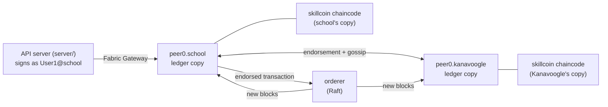

# Hyperledger Fabric: the skill coin ledger

Every skill coin a student earns is recorded on a **Hyperledger Fabric 2.5**
blockchain kept jointly by the school and Kanavoogle. MongoDB remains the
app's database (users, assessments, results). The ledger is the tamper-proof
record of coins that anyone on the network can verify. This is the split
chosen in the project plan: MongoDB is "not suitable as the immutable
verification layer", so Fabric fills that role.

Everything runs in Docker on your own machine or server. Nothing is hosted.



| Organisation | MSP ID | Runs | Can |
| --- | --- | --- | --- |
| The school | `SchoolMSP` | peer + chaincode | Issue and revoke coins, read |
| Kanavoogle | `KanavoogleMSP` | peer + chaincode | Co-endorse every transaction, read and verify |
| Ordering service | `OrdererMSP` | orderer | Order transactions into blocks (can't create or alter them) |

**Every transaction must be endorsed by both organisations**
(`AND('SchoolMSP.peer','KanavoogleMSP.peer')`), so neither can write to
the ledger alone.

---

## Quick start

Requires Docker, Node.js 22 and pnpm. The first run downloads about 1.5 GB of Fabric images.

```bash
pnpm install
pnpm db:up                   # MongoDB (see mongodb/README.md)
pnpm fabric:up               # build the network: certificates, channel, chaincode (~1 min the first time)
pnpm dev:full                # API server + app
```

You don't need to sync anything by hand: when a teacher releases results,
the app writes the skill coins to the ledger in the background, and retries
every 5 minutes if the network was down. `pnpm ledger:sync` does it on demand.

---

## Showing it to the customer

Use a test installation with a few real test accounts (see the main README):
an admin, a teacher and two students in one class, with one assessment
sat, marked and released.

**Talk track:**

1. **Blockchain Ledger → "Who keeps the ledger"** (admin). Two organisations
   each keep a full copy. A coin only exists if both run the smart contract,
   agree and sign. Neither can change history alone, not even the school.
2. **A student's wallet** (section 2), read live from the blockchain. The
   ledger holds only the wallet ID, never names or emails. Every skill
   matches the school's records.
3. **Evidence check** (section 3). When coins are issued, a SHA-256
   fingerprint of the assessment result goes on the ledger. Every row shows
   ✓ Genuine.
4. **Release a result live.** As the teacher, release a marked result
   (Marking & Release). Open **Skill Coins** as admin: within seconds the new
   coins show the block they were written to.
5. **Public Verification** (as an employer would). As the student, create a
   link in **Sharing & Privacy** and open it in a private window. It checks
   the ledger live and shows only the skills the student chose to share.
6. **Revocation.** As admin, revoke some coins (Skill Coins → Revoke, with a
   reason). The ledger keeps the original issue and adds a revocation: nothing
   is ever deleted. The student sees the reason in their access log.
7. **Privacy.** As the teacher, open a student who hasn't given consent: the
   individual results are refused, and the attempt appears in both the
   teacher's and the student's access logs. The audit log's own hash chain
   check passes.
8. **Audit from the command line:** `pnpm ledger:verify --probe` checks every
   wallet against the database and shows Kanavoogle being refused when it
   tries to mint coins.

**Showing tamper detection** (test installation only, never on real
records): note a released result's score, change it directly in the
database, and show that the Blockchain Ledger screen, the student's
verification link and `pnpm ledger:verify` all report the change. Then put
the original score back.

```bash
pnpm db:shell
> db.assessmentattempts.findOne({ status: "released" }, { "result.percent": 1 })   // note _id and percent
> db.assessmentattempts.updateOne({ _id: ObjectId("...") }, { $set: { "result.percent": 100 } })
> // ...show it, then restore:
> db.assessmentattempts.updateOne({ _id: ObjectId("...") }, { $set: { "result.percent": <original> } })
```

**Likely questions:**

- *Why not Ethereum?* Fabric is permissioned. Only known organisations
  join, there are no transaction fees, and data isn't public. That suits
  student records.
- *What if the school's server is hacked?* The attacker can change MongoDB,
  but not the ledger copy Kanavoogle holds, and the fingerprints expose the
  change. Issuing new coins needs Kanavoogle's endorsement too.
- *Where is student data?* In the school's MongoDB. The ledger stores only
  wallet ID, skill, coin amount, an evidence fingerprint, the issuer and a
  timestamp.
- *Can a student control sharing?* Yes. Verification links (in MongoDB)
  disclose only the skills the student chooses. Each coin shown can then
  be checked against the ledger.

---

## How it works

### The smart contract (`chaincode/skillcoin`)

TypeScript, using `fabric-contract-api`. It runs as a service: each
organisation runs its own copy in a container, so peers never need access
to the Docker socket.

| Function | Who | What it does |
| --- | --- | --- |
| `IssueCoins(eventId, walletId, skill, coins, evidenceHash)` | SchoolMSP only | Records coins earned from an assessment. Refuses unknown skills, bad amounts, a repeated event ID, or coins already issued for that assessment and skill |
| `RevokeCoins(eventId, revokesEventId, reason)` | SchoolMSP only | Adds a "revoked" entry. The original stays on the ledger. Each issuance can be revoked once |
| `GetWallet(walletId)` | anyone on the channel | Balance per skill and every entry behind it |
| `GetEvent(eventId)` / `GetEventHistory(eventId)` | anyone | One entry, and every write ever made to it (always exactly one) |
| `VerifyEvidence(eventId, evidenceHash)` | anyone | Checks an off-chain assessment result against the fingerprint recorded on-chain |

### From MongoDB to the ledger

1. A released assessment creates `walletevents` in MongoDB with `ledger.status: "pending"`.
2. `pnpm ledger:sync` (or `syncWalletEventsToLedger()` from `server/ledger`)
   computes each result's **evidence fingerprint**. This is a SHA-256 of the
   answers, marks, skill scores and grade (`server/ledger/evidence.ts`). It then
   submits `IssueCoins` through the school's peer. The Fabric Gateway collects
   Kanavoogle's endorsement, sends the transaction to the orderer and waits
   for the block.
3. The event is marked `committed` with its transaction ID and block number.
   It is safe to re-run, and anything already on the ledger is skipped.

The app code is in [`server/ledger`](../server/ledger). It covers the gateway
connection, contract calls, sync and a block reader (`explorer.ts`). The block
reader recalculates block hashes, so the Blockchain Ledger screen can show that the chain
links up.

### Commands

| Command | What it does |
| --- | --- |
| `pnpm fabric:up` | First run: generate certificates, create the channel, deploy the chaincode. Later runs: start the existing network |
| `pnpm fabric:down` | Stop the network. The ledger is kept |
| `pnpm fabric:status` | Containers, block height, chaincode definition |
| `pnpm fabric:clean` | **Delete** the network, ledger and certificates. Afterwards run `pnpm ledger:sync --resync` |
| `pnpm ledger:sync` | Send pending coins from MongoDB to the ledger now (the app also does this automatically) |
| `pnpm ledger:verify` | Read-only audit: ledger balances and evidence fingerprints vs the database (`--probe`: also show Kanavoogle can't issue) |

### Files

| Path | Purpose |
| --- | --- |
| `network.sh` | Builds and runs the network. All Fabric tools run inside the `hyperledger/fabric-tools` image |
| `docker-compose.yaml` | Orderer, two peers, two chaincode services |
| `config/crypto-config.yaml` | Organisations and identities (input to `cryptogen`) |
| `config/configtx.yaml` | Channel definition: organisations, policies, Raft orderer, anchor peers |
| `chaincode/skillcoin/` | The smart contract and its Dockerfile |
| `organizations/`, `channel-artifacts/`, `packages/`, `.env` | Generated by `network.sh` (gitignored). `organizations/` holds the private keys |

### App settings (optional, in `.env.local`)

| Variable | Default |
| --- | --- |
| `FABRIC_SCHOOL_PEER_ENDPOINT` | `localhost:7051` |
| `FABRIC_KANAVOOGLE_PEER_ENDPOINT` | `localhost:9051` |
| `FABRIC_ORGANIZATIONS_DIR` | `fabric/organizations` |
| `FABRIC_CHANNEL` / `FABRIC_CHAINCODE` | `skillschannel` / `skillcoin` |
| `LEDGER_RETRY_MS` / `LEDGER_SYNC` | How often unsynced coins are retried (default 5 minutes) / `off` to sync only with `pnpm ledger:sync` |

---

## Running on a server, and towards production

The same `pnpm fabric:up` works on any Linux server with Docker. Peer
ports are bound to `127.0.0.1` by default, so only the app on the same
machine can reach them. Set `FABRIC_BIND_IP` to change that, and
firewall the ports.

For a single school this setup is ready to use as it is (see
[`deploy/README.md`](../deploy/README.md)). As the network grows to more
schools and partners, it should change in these ways:

- **Each organisation runs its own nodes on its own infrastructure.** Here
  both run on one machine for convenience.
- **Identities from Fabric CA** instead of `cryptogen`, so staff
  certificates can be enrolled, renewed and revoked. This also fits the
  plan's certificate-based staff keys with 2FA.
- **Three or more orderers** (ideally run by different organisations), so
  the network survives a node failure.
- **TLS between peers and chaincode**, and secrets such as private keys in a
  vault rather than on disk.
- **New schools join as organisations** through a channel configuration
  update, and are added to the chaincode's issuer list.

## Troubleshooting

| Problem | Fix |
| --- | --- |
| `Found a partly created network` | A previous `up` stopped halfway. Run `pnpm fabric:clean`, then `pnpm fabric:up` |
| Blockchain Ledger screen: "certificates not found" | The network has never been started on this machine. Run `pnpm fabric:up` |
| Coins show "Waiting" or "Failed" | Check `pnpm fabric:status`, then Admin → Skill Coins → **Retry blockchain sync** (or `pnpm ledger:sync`) |
| Ledger balances don't match after wiping the database | The ledger keeps every coin ever issued (by design). On a test install, start a fresh ledger too: `pnpm fabric:clean && pnpm fabric:up` |
| Everything says "already on the ledger" after `fabric:clean` | MongoDB still has the old status. Run `pnpm ledger:sync --resync` |
| Port 7051 or 9051 is in use | Stop the other program, or change the host port mappings in `docker-compose.yaml` and set `FABRIC_*_PEER_ENDPOINT` |
| Windows | Run the commands in WSL2 or Git Bash, with Docker Desktop |
| Changed the chaincode | For development: `fabric:clean`, `fabric:up`, then `ledger:sync --resync`. A live network would bump `CC_VERSION`/`CC_SEQUENCE` in `network.sh` and re-approve instead |
| Image build can't reach npm (corporate proxy) | Build `dsw/skillcoin-chaincode:1.0` some other way (or pull it from a registry), then run `SKIP_CHAINCODE_BUILD=1 pnpm fabric:up` |
