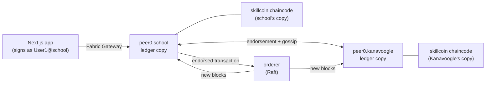

# Hyperledger Fabric: the skill coin ledger

Every skill coin a student earns is recorded on a **Hyperledger Fabric 2.5**
blockchain kept jointly by the school and Kanavoogle. MongoDB remains the
app's database (users, assessments, results). The ledger is the tamper-proof
record of coins that anyone on the network can verify. This is the split
chosen in the project plan: MongoDB is "not suitable as the immutable
verification layer", so Fabric fills that role.

Everything runs in Docker on your own machine or server. Nothing is hosted.



| Organisation | MSP ID | Runs | Can |
| --- | --- | --- | --- |
| Northview Secondary School | `SchoolMSP` | peer + chaincode | Issue and revoke coins, read |
| Kanavoogle | `KanavoogleMSP` | peer + chaincode | Co-endorse every transaction, read and verify |
| Ordering service | `OrdererMSP` | orderer | Order transactions into blocks (can't create or alter them) |

**Every transaction must be endorsed by both organisations**
(`AND('SchoolMSP.peer','KanavoogleMSP.peer')`), so neither can write to
the ledger alone.

---

## Quick start

Requires Docker (and Node.js for the app). The first run downloads about 1.5 GB of Fabric images.

```bash
npm run db:up && npm run db:seed   # MongoDB with demo data (see mongodb/README.md)
npm run fabric:up                  # build the network: certificates, channel, chaincode (~1 min the first time)
npm run ledger:sync                # write the demo skill coins from MongoDB to the ledger
npm run dev                        # open http://localhost:3000/demo/ledger
```

`npm run ledger:demo` runs a narrated walkthrough in the terminal.

---

## Showing it to the customer

**Before the meeting** (about 5 minutes):

```bash
npm run db:up && npm run db:seed -- --reset
npm run fabric:up && npm run ledger:sync
npm run dev
```

Open <http://localhost:3000/demo/ledger> and have a terminal ready.

**Talk track:**

1. **"Who keeps the ledger"** (section 1). Two organisations each keep a full
   copy. A coin only exists if both run the smart contract, agree and sign.
   Neither can change history alone, not even the school.
2. **Jordan's wallet** (section 2). This is read live from the blockchain.
   Point out the 🔒 note: the ledger holds only the wallet ID, never names
   or emails. Every skill matches the school's records.
3. **Evidence check** (section 3). When coins are issued, a fingerprint of
   the assessment result goes on the ledger. All three show ✓ Genuine.
4. **Live tamper.** In the terminal, run `npm run ledger:demo -- tamper`.
   This changes Jordan's Science result from 76% to 100% directly in the
   database, as an attacker or an insider might. Refresh the page: section 3
   shows ✗ **Changed after recording**. Run `npm run ledger:demo -- restore`
   and refresh to show ✓ again.
5. **The chain** (section 5). Each block carries the fingerprint of the one
   before it. Every coin transaction is endorsed by SchoolMSP +
   KanavoogleMSP.
6. **Attacks** (terminal): `npm run ledger:demo -- --pause` steps through
   Kanavoogle trying to mint 500 coins (refused: "Access denied") and the
   school trying to issue the same coins twice (refused). Press Enter
   between steps.

**Likely questions:**

- *Why not Ethereum?* Fabric is permissioned. Only known organisations
  join, there are no transaction fees, and data isn't public. That suits
  student records.
- *What if the school's server is hacked?* The attacker can change MongoDB,
  but not the ledger copy Kanavoogle holds, and the fingerprints expose the
  change. Issuing new coins needs Kanavoogle's endorsement too.
- *Where is student data?* In the school's MongoDB. The ledger stores only
  wallet ID, skill, coin amount, an evidence fingerprint, the issuer and a
  timestamp.
- *Can a student control sharing?* Yes. Verification links (in MongoDB)
  disclose only the skills the student chooses. Each coin shown can then
  be checked against the ledger.

---

## How it works

### The smart contract (`chaincode/skillcoin`)

TypeScript, using `fabric-contract-api`. It runs as a service: each
organisation runs its own copy in a container, so peers never need access
to the Docker socket.

| Function | Who | What it does |
| --- | --- | --- |
| `IssueCoins(eventId, walletId, skill, coins, evidenceHash)` | SchoolMSP only | Records coins earned from an assessment. Refuses unknown skills, bad amounts, a repeated event ID, or coins already issued for that assessment and skill |
| `RevokeCoins(eventId, revokesEventId, reason)` | SchoolMSP only | Adds a "revoked" entry. The original stays on the ledger. Each issuance can be revoked once |
| `GetWallet(walletId)` | anyone on the channel | Balance per skill and every entry behind it |
| `GetEvent(eventId)` / `GetEventHistory(eventId)` | anyone | One entry, and every write ever made to it (always exactly one) |
| `VerifyEvidence(eventId, evidenceHash)` | anyone | Checks an off-chain assessment result against the fingerprint recorded on-chain |

### From MongoDB to the ledger

1. A released assessment creates `walletevents` in MongoDB with `ledger.status: "pending"`.
2. `npm run ledger:sync` (or `syncWalletEventsToLedger()` from `@/lib/ledger`)
   computes each result's **evidence fingerprint**. This is a SHA-256 of the
   answers, marks, skill scores and grade (`lib/ledger/evidence.ts`). It then
   submits `IssueCoins` through the school's peer. The Fabric Gateway collects
   Kanavoogle's endorsement, sends the transaction to the orderer and waits
   for the block.
3. The event is marked `committed` with its transaction ID and block number.
   It is safe to re-run, and anything already on the ledger is skipped.

The app code is in [`lib/ledger`](../lib/ledger). It covers the gateway
connection, contract calls, sync and a block reader (`explorer.ts`). The block
reader recalculates block hashes, so the demo page can show that the chain
links up.

### Commands

| Command | What it does |
| --- | --- |
| `npm run fabric:up` | First run: generate certificates, create the channel, deploy the chaincode. Later runs: start the existing network |
| `npm run fabric:down` | Stop the network. The ledger is kept |
| `npm run fabric:status` | Containers, block height, chaincode definition |
| `npm run fabric:clean` | **Delete** the network, ledger and certificates. Afterwards run `npm run ledger:sync -- --resync` |
| `npm run ledger:sync` | Send pending coins from MongoDB to the ledger |
| `npm run ledger:demo` | Narrated walkthrough (`-- --pause`, `-- tamper`, `-- restore`) |

### Files

| Path | Purpose |
| --- | --- |
| `network.sh` | Builds and runs the network. All Fabric tools run inside the `hyperledger/fabric-tools` image |
| `docker-compose.yaml` | Orderer, two peers, two chaincode services |
| `config/crypto-config.yaml` | Organisations and identities (input to `cryptogen`) |
| `config/configtx.yaml` | Channel definition: organisations, policies, Raft orderer, anchor peers |
| `chaincode/skillcoin/` | The smart contract and its Dockerfile |
| `organizations/`, `channel-artifacts/`, `packages/`, `.env` | Generated by `network.sh` (gitignored). `organizations/` holds the private keys |

### App settings (optional, in `.env.local`)

| Variable | Default |
| --- | --- |
| `FABRIC_SCHOOL_PEER_ENDPOINT` | `localhost:7051` |
| `FABRIC_KANAVOOGLE_PEER_ENDPOINT` | `localhost:9051` |
| `FABRIC_ORGANIZATIONS_DIR` | `fabric/organizations` |
| `FABRIC_CHANNEL` / `FABRIC_CHAINCODE` | `skillschannel` / `skillcoin` |
| `ENABLE_LEDGER_DEMO` | Set to `true` to serve `/demo/ledger` when `NODE_ENV=production` (it is off in production by default, as it has no login) |

---

## Running on a server, and towards production

The same `npm run fabric:up` works on any Linux server with Docker. Peer
ports are bound to `127.0.0.1` by default, so only the app on the same
machine can reach them. Set `FABRIC_BIND_IP` to change that, and
firewall the ports.

This network is built for development and demonstration. A production
deployment would differ in these ways:

- **Each organisation runs its own nodes on its own infrastructure.** Here
  both run on one machine for convenience.
- **Identities from Fabric CA** instead of `cryptogen`, so staff
  certificates can be enrolled, renewed and revoked. This also fits the
  plan's certificate-based staff keys with 2FA.
- **Three or more orderers** (ideally run by different organisations), so
  the network survives a node failure.
- **TLS between peers and chaincode**, and secrets such as private keys in a
  vault rather than on disk.
- **New schools join as organisations** through a channel configuration
  update, and are added to the chaincode's issuer list.

## Troubleshooting

| Problem | Fix |
| --- | --- |
| `Found a partly created network` | A previous `up` stopped halfway. Run `npm run fabric:clean`, then `npm run fabric:up` |
| Demo page: "certificates not found" | The network has never been started on this machine. Run `npm run fabric:up` |
| Coins show "Not on ledger yet" | Run `npm run ledger:sync` |
| Everything says "already on the ledger" after `fabric:clean` | MongoDB still has the old status. Run `npm run ledger:sync -- --resync` |
| Port 7051 or 9051 is in use | Stop the other program, or change the host port mappings in `docker-compose.yaml` and set `FABRIC_*_PEER_ENDPOINT` |
| Windows | Run the commands in WSL2 or Git Bash, with Docker Desktop |
| Changed the chaincode | For development: `fabric:clean`, `fabric:up`, then `ledger:sync -- --resync`. A live network would bump `CC_VERSION`/`CC_SEQUENCE` in `network.sh` and re-approve instead |
| Image build can't reach npm (corporate proxy) | Build `dsw/skillcoin-chaincode:1.0` some other way (or pull it from a registry), then run `SKIP_CHAINCODE_BUILD=1 npm run fabric:up` |
